<div align="center">

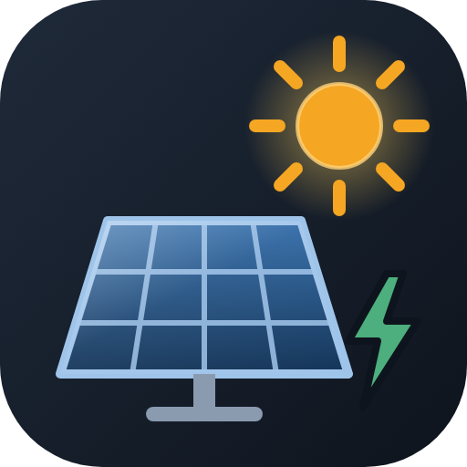

# FVE Card

**Animated energy‑flow card for Home Assistant – SolaX, Huawei, Fronius, GoodWe, Deye, SolarEdge …**

<sub>formerly *SolaX FVE Card* – the card type stays `custom:solax-fve-card`, nothing to change in your dashboards</sub>

PV strings · inverter · battery with SOC control · grid & tariff · loads · wallbox & EV

[](https://hacs.xyz)
[](https://github.com/tomasbobala/solax-fve-card/releases)
[](LICENSE)
[](https://github.com/tomasbobala/solax-fve-card/actions)

**English** · [Slovensky](README.sk.md)

[](https://my.home-assistant.io/redirect/hacs_repository/?owner=tomasbobala&repository=solax-fve-card&category=plugin)

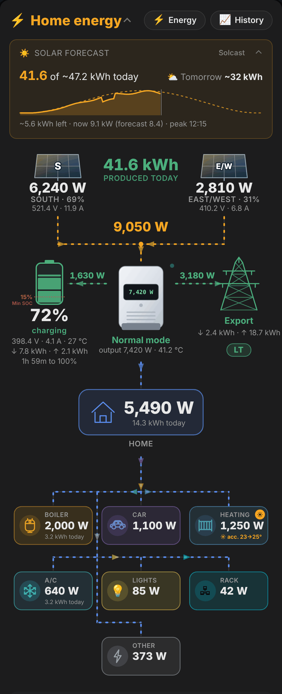

<sub>Live recording of the card: moving arrows follow the power, every load gets its own coloured arrow from the house.</sub>

</div>

---

## Contents

- [Features](#features)
- [Requirements](#requirements)
- [Installation](#installation)
- [Quick start](#quick-start)
- [Configuration](#configuration)
- [Examples](#examples)
- [Screenshots](#screenshots)
- [Troubleshooting](#troubleshooting)
- [Development](#development)
- [License](#license)

## Features

| | |
|---|---|
| 🌞 **Solar** | Two or **three** PV strings with power, voltage, current and share, their sum and the energy produced today. At night the strings collapse into a single compact row. |
| 🔆 **Inverter** | Built‑in drawn inverter (or your own photo), run mode, AC output, temperature and a Modbus communication health dot. |
| 🔋 **Battery** | Segmented battery icon, SOC, charge/discharge direction, V/A/°C, daily kWh, runtime estimate, **MIN/MAX SOC markers** and sliders to change them. **Several batteries** can be combined and shown as one. |
| 🗼 **Grid** | Import/export with direction colours, daily import/export and an optional low/high‑tariff badge. |
| 🏠 **Home & loads** | Big home node with total consumption and any number of loads (boiler, car, heating, A/C, …) drawn as line icons that light up when active. Lay them out in **one row, several rows or as tiles**; an **Other** tile shows the unmeasured rest. A/C icons switch between ❄️ and 🔥 by HVAC mode. |
| 🚗 **Wallbox & EV** | Charging power bar, status, **GREEN · ECO · FAST · STOP / START** mode buttons, charging current slider, car SOC with target, range, time remaining and charge limit. Optional **second wallbox** with its own panel. |
| ✨ **Animation** | Moving, pulsing arrows along each flow – speed follows the power. With tiles every load gets its own coloured arrow travelling from the house. |
| 🌍 **Languages** | English and Slovak, picked automatically from Home Assistant (or forced per card). |
| 🛠️ **Visual editor** | Everything is configurable in the UI – no YAML needed. Entities of the `solax_modbus` integration are discovered automatically. |
| 🌤️ **Forecast** | Forecast.Solar / Solcast: produced vs. forecast today, tomorrow, remaining, curve with real production. |
| 📈 **Day profile** | Production, forecast, home consumption and battery SOC for today or yesterday, with **self‑sufficiency** and **self‑consumption** rings. |
| ⚡ **Phase load** | Current per phase against your main breaker, warning and pylon badge when a phase is close to the limit. |
| ⚠️ **Stale data** | Badge, banner and greyed‑out diagram when the inverter stops sending data. |
| 🗂️ **Sections** | Every section can be collapsed; the state is saved into the card config. |
| 🔌 **Brands & more** | Entity presets for SolaX, Huawei, Fronius, GoodWe, Deye/Sunsynk, SolarEdge; several inverters; tap actions per node; Smart Heating accumulation badge. |
| 📦 **Zero dependencies** | One plain JavaScript file, no build step, no external requests. |

## Requirements

- Home Assistant **2023.9** or newer
- Recommended: the [SolaX Modbus](https://github.com/wills106/homeassistant-solax-modbus) integration (`solax_modbus`).
  Other brands have presets (see [Other inverter brands](#other-inverter-brands)) and any other source works too – you just pick the entities in the editor.
- Optional: [Forecast.Solar](https://www.home-assistant.io/integrations/forecast_solar/) or [Solcast](https://github.com/BJReplay/ha-solcast-solar) for the forecast, [Smart Heating](https://github.com/tomasbobala/smart_heating) for the accumulation badge.

## Installation

### HACS (recommended)

1. Click the button below – it opens HACS in your Home Assistant with this repository pre‑filled:

   [](https://my.home-assistant.io/redirect/hacs_repository/?owner=tomasbobala&repository=solax-fve-card&category=plugin)

   Or manually: **HACS → ⋮ → Custom repositories**, URL `https://github.com/tomasbobala/solax-fve-card`, type **Dashboard**.
2. Search for **FVE Card** (formerly *SolaX FVE Card*) and click **Download**.
3. Reload the browser (on mobile: close and reopen the app).

HACS registers the resource automatically.

### Manual

1. Download `solax-fve-card.js` from the [latest release](https://github.com/tomasbobala/solax-fve-card/releases/latest).
2. Copy it to `<config>/www/solax-fve-card.js`.
3. **Settings → Dashboards → ⋮ → Resources → Add resource**
   - URL: `/local/solax-fve-card.js?v=1.0.0`
   - Type: **JavaScript module**
4. Reload the browser. After every update, increase the `?v=` number so browsers load the new file.

## Quick start

1. Open a dashboard → **Edit** → **Add card** → search for **FVE Card**.
2. The card fills in the `solax_modbus` entities it finds. Check the sections in the editor and adjust what is needed.
3. Add your loads (boiler, heating, A/C …) in the **Loads** section.

Minimal YAML:

```yaml
type: custom:solax-fve-card
entities:
  solar_power: sensor.solax_pv_power_total
  battery_power: sensor.solax_battery_power_charge
  battery_soc: sensor.solax_battery_capacity
  grid_power: sensor.solax_measured_power
  total_power: sensor.solax_house_load
```

## Configuration

All options are optional unless marked otherwise. Everything below can be set in the visual editor.

### General

| Option | Type | Default | Description |
|---|---|---|---|
| `type` | string | **required** | `custom:solax-fve-card` |
| `language` | string | `auto` | `auto` (from Home Assistant), `en` or `sk` |
| `title` | string | `Home energy` | Card title |
| `title_icon` | string | `⚡` | Emoji in front of the title, empty string = none |
| `links` | list | Energy button | Buttons in the header – see [Links](#links) |
| `power_unit` | string | `W` | `W`, `kW` or `auto` |
| `decimals` | number | `2` | Decimal places for kW |
| `animation_speed` | string | `normal` | `slow`, `normal`, `fast` |
| `colors` | map | – | See [Colors](#colors) |
| `show` | map | – | See [Display switches](#display-switches) |
| `brand` | string | detected | `solax`, `huawei`, `fronius`, `goodwe`, `deye`, `solaredge`, `generic` – see [Other inverter brands](#other-inverter-brands) |
| `collapsed` | map | – | Collapsed sections – see [Card sections](#card-sections) |
| `stale_minutes` | number | `10` | Stale data warning after this many minutes |
| `phase_limit_a` | number | `25` | Breaker per phase (A) – see [Phase load](#phase-load) |
| `phase_warn_pct` | number | `80` | Phase warning from this % of the breaker |
| `tap_actions` | map | – | See [Tap actions](#tap-actions) |
| `inverters`, `inverter_label` | list, string | – | See [More inverters](#more-inverters) |

### Entities

Set under `entities:`. Power entities in kW are converted automatically.

| Key | Description | Typical `solax_modbus` entity |
|---|---|---|
| `pv1_power`, `pv2_power` | String power | `sensor.solax_pv_power_1`, `_2` |
| `pv1_voltage`, `pv2_voltage` | String voltage | `sensor.solax_pv_voltage_1`, `_2` |
| `pv1_current`, `pv2_current` | String current | `sensor.solax_pv_current_1`, `_2` |
| `pv3_power`, `pv3_voltage`, `pv3_current` | Third string (optional) – see [Third string](#third-string) | `sensor.solax_pv_power_3` … |
| `solar_power` | Total PV power | `sensor.solax_pv_power_total` |
| `solar_today` | Produced today (kWh) | `sensor.solax_today_s_solar_energy` |
| `inverter_status` | Run mode | `sensor.solax_run_mode` |
| `inverter_power` | Inverter AC power | `sensor.solax_inverter_power` |
| `inverter_temp` | Inverter temperature | `sensor.solax_inverter_temperature` |
| `inverter_comm_health`, `inverter_comm_rate` | Communication health / success rate | – |
| `inverter_voltage_l1…l3`, `inverter_current_l1…l3` | Per‑phase values | `sensor.solax_inverter_voltage_l1` … |
| `grid_power` | Grid power, **+ import / − export** | `sensor.solax_measured_power` |
| `grid_power_l1…l3`, `grid_voltage_l1…l3` | Per‑phase values | `sensor.solax_measured_power_l1` … |
| `grid_import_today`, `grid_export_today` | Daily import / export | `sensor.solax_today_s_import_energy` … |
| `tariff_low` | ON = low tariff (badge) | any `switch` / `binary_sensor` |
| `tariff_enabled` | Dot next to the badge | any `input_boolean` |
| `battery_power` | Battery power, **+ charge / − discharge** | `sensor.solax_battery_power_charge` |
| `battery_soc` | State of charge (%) | `sensor.solax_battery_capacity` |
| `battery_voltage`, `battery_current`, `battery_temp` | Battery details | `sensor.solax_battery_voltage_charge` … |
| `battery_charge_today`, `battery_discharge_today` | Daily energy | `sensor.solax_battery_input_energy_today` … |
| `battery_capacity` | BMS capacity (Wh) for the runtime estimate | `sensor.solax_bms_battery_capacity` |
| `battery_min_soc` | MIN SOC `number` (marker + slider) | `number.solax_selfuse_discharge_min_soc` |
| `battery_max_soc` | MAX SOC `number` (marker + slider) | `number.solax_battery_charge_upper_soc` |
| `total_power`, `total_today` | Home consumption / today | `sensor.solax_house_load` |
| `wallbox_power` | Charging power | `sensor.solax_wallbox_charge_power_total` |
| `wallbox_status` | Charger state | `sensor.solax_wallbox_run_mode` |
| `wallbox_mode` | Charging mode `select` | `select.solax_wallbox_charge_mode` |
| `wallbox_stop` | Entity that stops charging (`select`, `switch`, `button`) | auto: `select.<prefix>_control_command` |
| `wallbox_current` | Charging current `number` | `number.solax_wallbox_charge_current` |
| `wallbox_added`, `wallbox_today`, `wallbox_temp` | Session / daily energy, temperature | – |
| `wallbox_comm_health`, `wallbox_comm_rate` | Communication health | – |
| `car_soc`, `car_target_soc`, `car_range`, `car_time_remaining` | Car battery from your car integration | – |
| `car_limit` | Car charge limit `number` (slider) | – |
| `car_plug`, `car_state` | Charger connected / charging state | – |
| `wb2_…` | Every wallbox / car key above with the `wb2_` prefix – the second wallbox | – |

### Layout and labels

| Option | Type | Default | Description |
|---|---|---|---|
| `pv1_label`, `pv2_label`, `pv3_label` | string | `String 1`, `String 2`, `String 3` | String names; the panel shows their initials (e.g. *East/West* → `E/W`) |
| `home_label`, `home_icon` | string | `Home`, `🏠` | Home node |
| `home_mode` | string | `total` | `total` = whole consumption, `remainder` = minus the loads below |
| `loads_layout` | string | `row` | `row` = one row (original), `rows` = circles in several rows, `tiles` = tiles in a grid |
| `loads_per_row` | number | `3` | Loads per row for `rows` and `tiles` |
| `other_label`, `other_icon`, `other_color` | string | `Other`, `🔌`, `#9aa0a8` | The OTHER tile (home minus measured loads) |
| `inverter_image` | string | – | Your own inverter picture, e.g. `/local/inverter.png` |
| `inverter_power_label` | string | `output` | Text in front of the inverter power, empty = none |
| `wallbox_image` | string | – | Your own wallbox picture |
| `wallbox_max_power` | number | `11000` | Full scale of the charging bar (W) |
| `wallbox_label` | string | `Wallbox` | Title of the wallbox panel |
| `wallbox2` | bool | `false` | Second wallbox – see [Second wallbox](#second-wallbox) |
| `wallbox2_label`, `wallbox2_image`, `wallbox2_max_power` | | `Wallbox 2`, –, `11000` | Same as above for the second wallbox |
| `invert_battery`, `invert_grid` | string | `auto` | `auto`, `yes`, `no` – flip the sign if your sensor uses the opposite convention |
| `battery_capacity_kwh` | number | from BMS | Capacity for the runtime estimate |
| `battery_runtime_target` | number | MIN SOC | Target % for the runtime estimate |
| `battery_segments` | number | `3` | Segments of the battery icon |
| `battery_label` | string | `1` | Name of battery 1 when there are more batteries |
| `batteries` | list | – | More batteries shown as one – see [Several batteries](#several-batteries) |

### Loads

```yaml
loads:
  - label: Boiler
    icon: 🚿            # emoji, drawn as a line icon
    color: "#e0a020"
    entity: sensor.boiler_power
    today: sensor.boiler_energy_today
  - label: Heating
    icon: ♨️
    entity: sensor.heating_living_room_power
    extra_entities: sensor.heating_bedroom_power, sensor.heating_bathroom_power
  - label: A/C
    icon: 🌡️
    entity: sensor.ac_power
    icon_entity: climate.living_room    # ❄️ when cooling, 🔥 when heating
```

| Key | Description |
|---|---|
| `label`, `icon`, `color` | Name, emoji and colour |
| `art` | Force a drawn icon: `home`, `boiler`, `car`, `heating`, `heat`, `cool`, `thermo`, `bolt`, `plug` |
| `entity` | Power entity |
| `extra_entities` | More power entities to add up, comma separated |
| `today`, `today_extra` | Daily energy entity / more to add up |
| `icon_entity` | `climate` entity – icon follows `hvac_action` / mode |
| `smart_heating` | Smart Heating zone status sensors, comma separated – see [Smart Heating](#smart-heating) |

Emoji mapped to drawn icons: 🏠 🏡 → home, 🚿 🛁 → boiler, ♨️ → heating, 🔥 → heat, ❄️ → cool, 🌡️ → thermo, 🚗 🚙 → car, 🔌 ⚡ → bolt.

### Third string

A third PV string is shown automatically as soon as `pv3_power` is set (the card picks up `sensor.…_pv_power_3`
on its own when the inverter has one). Without it the solar part stays exactly as before.

- Three panels side by side, each with power, share of the total, voltage and current.
- The strings are drawn left to right in order 1 · 2 · 3 – String 2 sits in the middle and feeds straight into the join point.
- With only two strings, leave *String 3 – power* empty and the card shows just two panels. If the entity is configured but does not exist in Home Assistant, it is ignored as well.
- The total power and the energy produced today move into one pill above the join point
  (e.g. `10 980 W · 41.6 kWh today`), because the space between the panels is taken.
- At night all three strings collapse into the single compact row as before.

```yaml
pv1_label: South
pv2_label: West
pv3_label: Garage
entities:
  pv3_power: sensor.solax_pv_power_3
  pv3_voltage: sensor.solax_pv_voltage_3     # optional
  pv3_current: sensor.solax_pv_current_3     # optional
```

### Several batteries

Battery 1 uses the `battery_*` entities above. Every further battery goes into `batteries:` and the card shows
them all as **one battery**:

| Value | How it is combined |
|---|---|
| Power, current, charged / discharged today, BMS capacity | added up |
| State of charge (SOC) | weighted by capacity (a bigger battery counts more); plain average when a capacity is missing |
| Voltage | average |
| Temperature | the highest one |
| Runtime estimate | uses the sum of all capacities |
| MIN / MAX SOC | from battery 1 (they belong to the inverter) |

The battery icon gets a **×N** badge and the details show every battery's own SOC (e.g. `A 72% · B 64%`).
A battery without `battery_power` is ignored.

```yaml
battery_label: A               # name of battery 1 in the per-battery line
battery_capacity_kwh: 11.5     # capacity of battery 1 (or its BMS sensor battery_capacity in Wh)
batteries:
  - label: B
    capacity_kwh: 10           # or battery_capacity: sensor.… (Wh)
    battery_power: sensor.battery_b_power          # + charge / − discharge
    battery_soc: sensor.battery_b_soc
    battery_voltage: sensor.battery_b_voltage
    battery_current: sensor.battery_b_current
    battery_temp: sensor.battery_b_temperature
    battery_charge_today: sensor.battery_b_charged_today
    battery_discharge_today: sensor.battery_b_discharged_today
```

Every key except `battery_power` is optional. In the editor: **Battery → More batteries → + Add battery**.

### Second wallbox

Off by default – with one wallbox the card looks exactly as before. Switch it on with `wallbox2: true`
(editor: **Wallbox → Second wallbox**) and a **Wallbox 2** section appears with the same fields as the first one.
The card then shows a second wallbox panel with its own title, modes, STOP / START and current slider.

Entities of the second wallbox use the same keys as the first one with a `wb2_` prefix:

```yaml
wallbox_label: Garage            # title of the first panel (default "Wallbox")
wallbox2: true
wallbox2_label: Yard             # title of the second panel (default "Wallbox 2")
wallbox2_max_power: 11000
entities:
  wb2_wallbox_power: sensor.wallbox_2_charge_power_total
  wb2_wallbox_status: sensor.wallbox_2_run_mode
  wb2_wallbox_mode: select.wallbox_2_charge_mode
  wb2_wallbox_current: number.wallbox_2_charge_current
  # wb2_wallbox_stop, wb2_car_soc, wb2_car_range, … – optional, like the first wallbox
```

The STOP entity is found automatically from the names of the second wallbox's entities, just like for the first one.
To see the second car among the loads (and get its own arrow), add it as a load with `entity: sensor.wallbox_2_charge_power_total`.

### Solar forecast

Install **Forecast.Solar** (built into Home Assistant, free) or **Solcast**. A new card finds the sensors on its own; for an existing card fill them in the editor under *Solar forecast*.

```yaml
entities:
  forecast_today: sensor.energy_production_today              # Forecast.Solar
  forecast_remaining: sensor.energy_production_today_remaining
  forecast_tomorrow: sensor.energy_production_tomorrow
  forecast_power_now: sensor.power_production_now             # optional
```

The strip under the header shows *produced of ~forecast kWh today*, tomorrow's forecast, what is left today, power now vs. forecast and the expected peak. The curve (dashed = forecast, solid = real production) comes from the Solcast `detailedForecast` attribute or – for Forecast.Solar – from the Energy dashboard forecast (add the forecast to your solar panels in **Settings → Dashboards → Energy**). Without a curve a simple progress bar is shown.

### Card sections

Forecast, energy flow, phase load, wallbox, battery settings, phase details, today and day profile can each be collapsed. Tap the section header – or the card title for the energy‑flow diagram (a compact row with the main values stays visible).

The state is saved into the card configuration (`collapsed:`), so it is the same on every device. This needs an **admin** user; for other users it is remembered in that browser only. Default states can be set in the editor under *Card sections*:

```yaml
collapsed:
  diagram: false
  phase_load: true
  chart: true
```

Keys: `diagram`, `forecast`, `phase_load`, `wallbox`, `wallbox2`, `battery_settings`, `phase_details`, `today`, `chart`. Battery settings and phase details start collapsed.

### Stale data warning

When none of the power entities (PV, inverter, grid, battery, home) has changed for `stale_minutes` (default **10**), the header shows **⚠ 12 min**, a banner with the time of the last change appears and the diagram is greyed out with the animation stopped. If all of them are unavailable the banner says so. Handy when the Modbus connection drops and the card would otherwise keep showing the last values.

### Self-sufficiency and day profile

The **Today** section shows two rings: *self‑sufficiency* = 1 − grid import / home consumption, *self‑consumption* = 1 − export / production (from the daily energy entities). Below them are the daily totals (`show.energy_today`).

**Day profile** draws production, forecast, home consumption and battery SOC for today or yesterday from the recorder (5‑minute statistics, history as a fallback). Tap or hover the chart to read the values at that time.

### Phase load

With per‑phase grid power (`grid_power_l1` – `l3`) the card shows the current of each phase against your main breaker, with the direction (↓ import, ↑ export). From `phase_warn_pct` (default 80 %) the bar turns orange (red at 100 %), a warning line appears and the pylon gets a **⚠ L2 22.6 A** badge.

```yaml
phase_limit_a: 25     # breaker per phase
phase_warn_pct: 80
```

Current = |power| / phase voltage (`grid_voltage_l1` – `l3`, otherwise 230 V).

### Smart Heating

If you use the [Smart Heating](https://github.com/tomasbobala/smart_heating) integration (0.23 or newer), a load can show when a zone stores PV surplus as heat. Add the zone status sensors to the load:

```yaml
loads:
  - label: Heating
    icon: ♨️
    entity: sensor.heating_power
    smart_heating: sensor.smart_heating_obyvacka_stav, sensor.smart_heating_kupelna_stav
```

While a zone accumulates, the tile gets a ☀ badge and **☀ acc. 23→25°** (target → maximum), or **☀ 2 zones** for several zones. Without the integration leave the field empty.

### Other inverter brands

`brand:` selects the entity preset used by the editor's **🔍 Find entities** button and by a new card (detected automatically): `solax`, `huawei` (Huawei Solar), `fronius`, `goodwe`, `deye` (Deye / Sunsynk via Solarman), `solaredge` (SolarEdge Modbus Multi), `generic`. The button only fills empty fields and also sets the sign options the brand needs (e.g. `invert_grid` for Huawei). The presets are best effort – check the result and adjust single entities if your integration names them differently.

### Tap actions

Every part of the diagram opens *more info* by default. Override it per node – `solar`, `battery`, `inverter`, `grid`, `home`, `loads`:

```yaml
tap_actions:
  battery:
    action: navigate
    navigation_path: /energy
  grid:
    action: url
    url_path: https://www.solaxcloud.com
  home:
    action: perform-action
    perform_action: script.show_consumption
  loads:
    action: none
```

Actions: `more-info` (optional `entity`), `navigate`, `url`, `perform-action` (`perform_action`, optional `data`, `target`), `toggle` (`entity`), `none`.

### More inverters

```yaml
inverter_label: House
inverters:
  - label: Garage
    inverter_power: sensor.solax_2_inverter_power
    solar_power: sensor.solax_2_pv_power_total
    solar_today: sensor.solax_2_today_s_solar_energy
```

Power and production of the other inverters are added to the solar part and to the inverter. The inverter gets a **×2** badge and a line with each inverter's power. Strings of the other inverters are not drawn separately.

### Links

```yaml
links:
  - label: Energy
    icon: ⚡
    path: /energy
  - label: Solar
    icon: 🔆
    color: "#f5a623"
    path: /lovelace/solar
  - label: SolaX Cloud
    icon: ☁️
    path: https://www.solaxcloud.com
```

`links: []` hides the buttons. Full `https://` addresses open in a new tab.

### Display switches

Set under `show:` (`true` / `false`).

| Key | Default | Description |
|---|---|---|
| `pv_split` | `true` | Separate display of strings (2 or 3 panels instead of one) |
| `pv_details` | `true` | Voltage / current / share % |
| `solar_sum` | `true` | Total of the strings (Σ) |
| `night_compact` | `true` | Collapse the strings when there is no production |
| `battery` | `true` | Battery node |
| `battery_details` | `true` | V / A / °C / daily kWh |
| `battery_settings` | `true` | MIN / MAX SOC sliders |
| `battery_runtime` | `true` | Runtime estimate |
| `grid` | `true` | Grid node |
| `grid_details` | `true` | Daily import / export |
| `tariff` | `true` | Tariff badge |
| `loads` | `true` | Loads |
| `dim_idle_loads` | `true` | Dim loads that draw nothing |
| `loads_other` | `true` | OTHER tile – unmeasured consumption (home minus loads), when at least one load is set |
| `wallbox_panel` | `true` | Wallbox panel |
| `wallbox_settings` | `true` | Charging current / car limit |
| `wallbox_stop` | `true` | STOP button next to the modes (turns into START while charging is stopped) |
| `wallbox_session` | `false` | Energy of the current session |
| `car` | `true` | Car battery |
| `diagnostics` | `true` | Communication dot |
| `phase_details` | `true` | Phase table |
| `energy_today` | `false` | Bottom row with daily totals |
| `translate_sk` | `true` | Translate device states into the card language |
| `animation` | `true` | Animated flows |
| `forecast` | `true` | Solar forecast strip (when forecast entities are set) |
| `self_sufficiency` | `true` | Self‑sufficiency / self‑consumption rings |
| `day_chart` | `true` | Day profile chart |
| `phase_load` | `true` | Phase load bars (needs per‑phase grid power) |
| `stale_warning` | `true` | Stale data warning |

### Colors

`colors:` keys: `solar`, `solar_today`, `hub`, `battery_charge`, `battery_discharge`, `grid_import`, `grid_export`, `home`, `wallbox`.

## Examples

A complete example is in [`examples/card.yaml`](examples/card.yaml).

## Screenshots

<p align="center">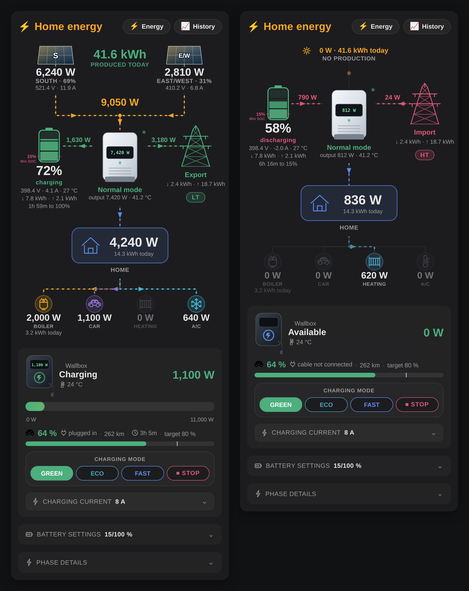</p>

| Day | Night | Details |
|---|---|---|
| 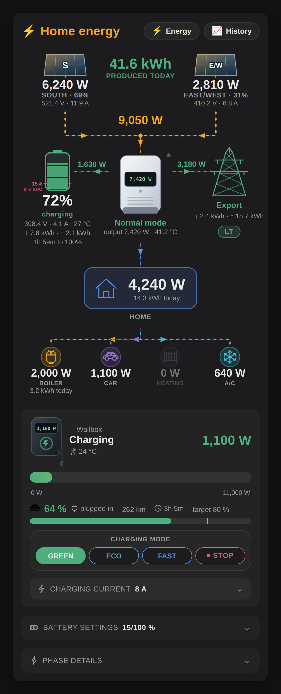 | 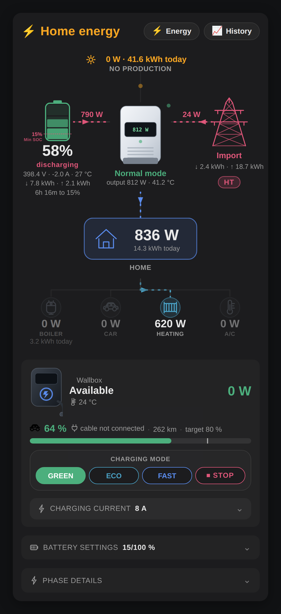 | 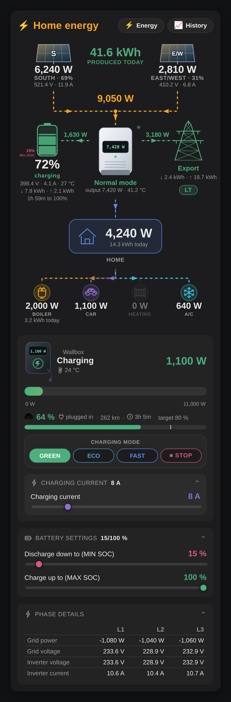 |

| Light theme | Slovak | Visual editor |
|---|---|---|
| 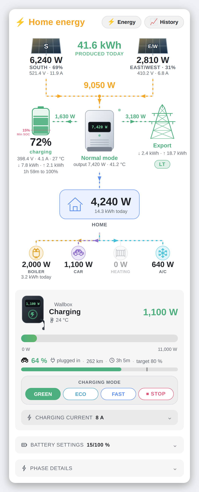 | 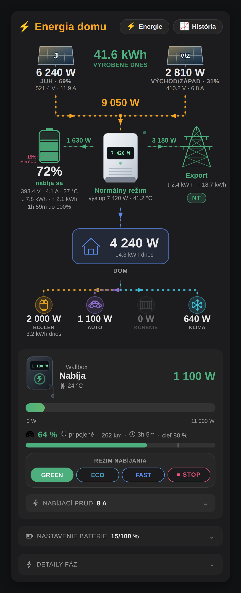 | 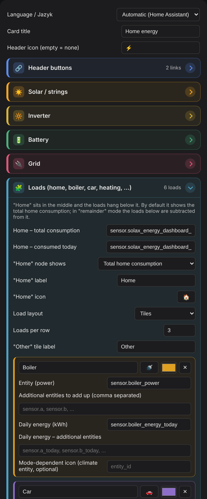 |

| Load tiles + Other | Two batteries + second wallbox | Three strings |
|---|---|---|
| 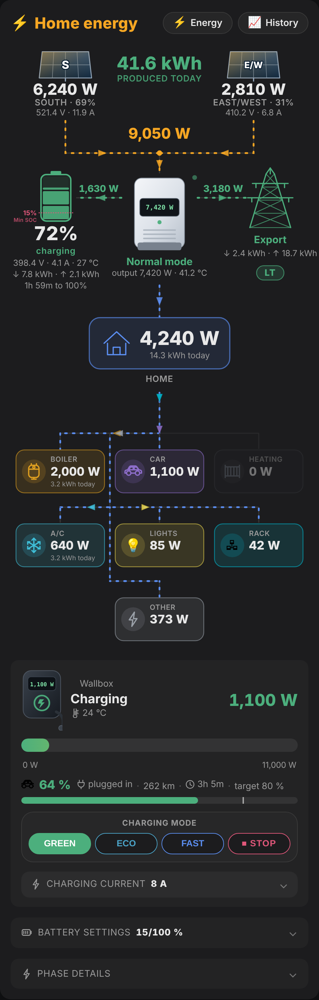 | 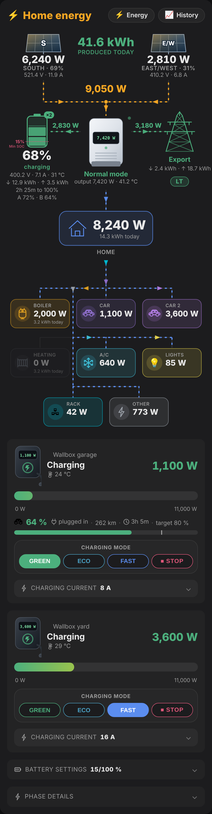 | 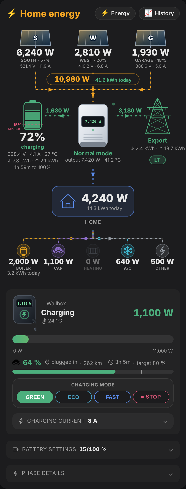 |

| Forecast, day profile, 2 inverters, Smart Heating | Collapsed sections | Phase load warning | Stale data |
|---|---|---|---|
| 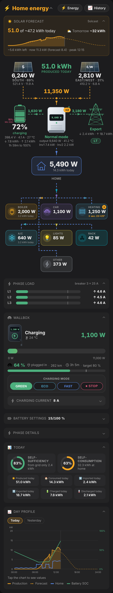 | 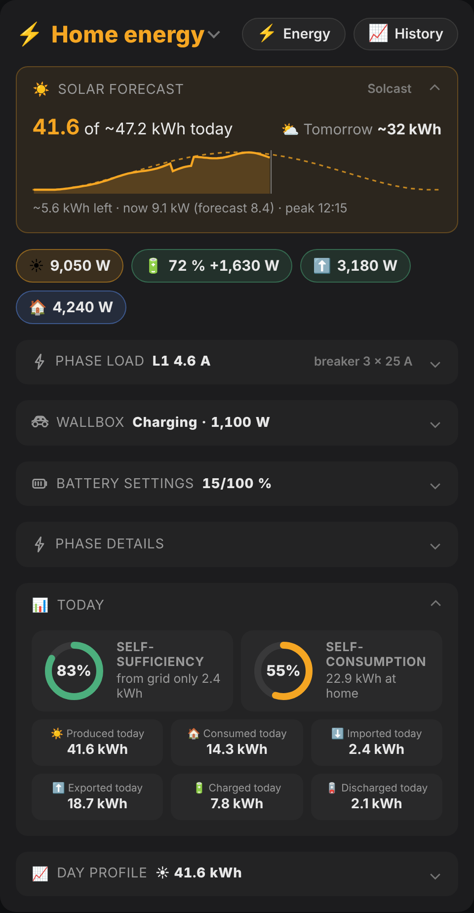 | 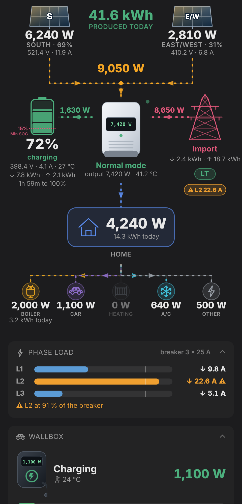 | 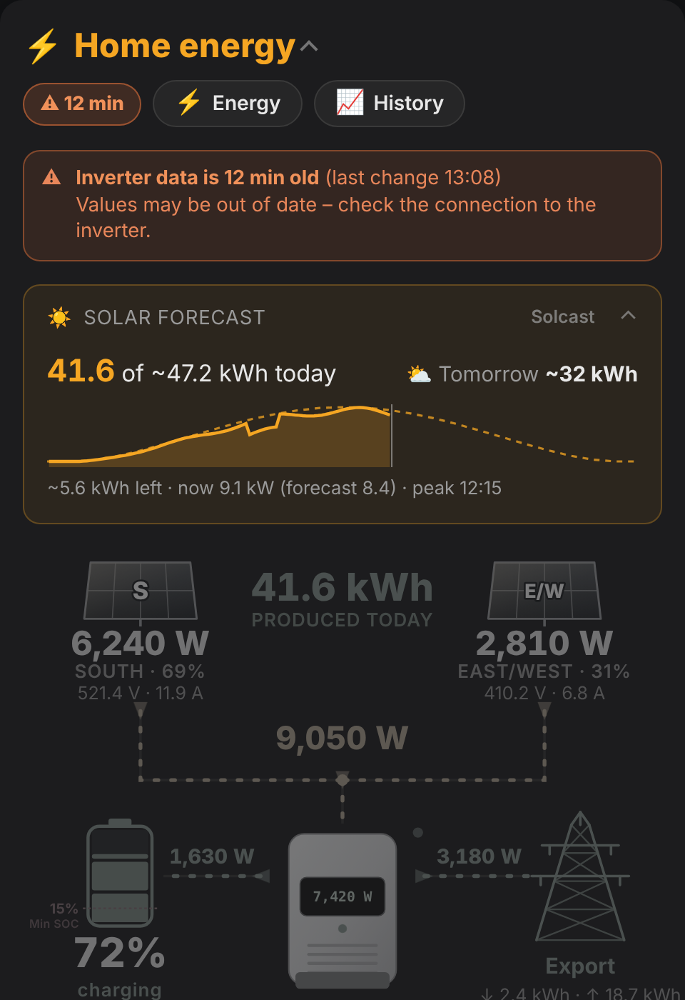 |

## Troubleshooting

<details>
<summary><b>The card is not in the card picker / "Custom element doesn't exist"</b></summary>

Check that the resource exists (**Settings → Dashboards → Resources**) and is of type *JavaScript module*. Then fully reload the browser (Ctrl + F5); on phones, clear the app cache.
</details>

<details>
<summary><b>Battery or grid arrows point the wrong way</b></summary>

Your sensor uses the opposite sign. Set **Invert battery power sign** / **Invert grid power sign** to *Yes* (`invert_battery: yes`, `invert_grid: yes`).
</details>

<details>
<summary><b>The STOP button is missing</b></summary>

The card looks for `<prefix>_control_command` next to your charging‑mode select. If your charger uses a different entity, set it as `entities.wallbox_stop` (a `select` with a *Stop* option, a `switch` or a `button`).
</details>

<details>
<summary><b>After an update the card still looks old</b></summary>

For manual installs, raise the `?v=` number of the resource. For HACS, reload the browser / app cache.
</details>

## Development

```bash
git clone https://github.com/tomasbobala/solax-fve-card.git
cd solax-fve-card
npm install
npm test              # unit tests (node:test + jsdom)
npx serve .           # then open http://localhost:3000/demo/?lang=en&view=day,night
```

The whole card is a single file: [`dist/solax-fve-card.js`](dist/solax-fve-card.js). The demo page accepts `lang=en|sk`, `view=day,night,details,editor` and `theme=light`.


## Contributing

Issues and pull requests are welcome – see [CONTRIBUTING.md](CONTRIBUTING.md). Translations into more languages are especially appreciated: add a block to `I18N` and `STATE_TEXT` in the card file.

## License

[MIT](LICENSE) © 2026 Tomáš Bobala

---

<sub>SolaX is a trademark of SolaX Power Network Technology (Zhejiang) Co., Ltd. This project is an independent community card and is not affiliated with or endorsed by SolaX Power.</sub>
